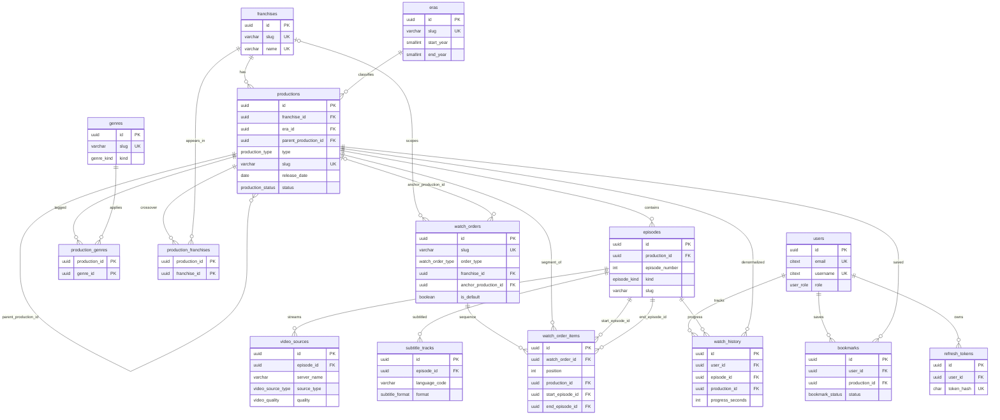
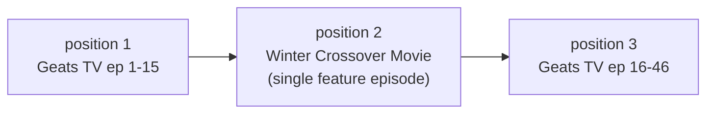

# 01_DATABASE_ARCHITECTURE

> Audience: Antigravity AI (autonomous coding agent). This file is the single source of truth for the relational schema of the Tokusatsu Streaming Website.
> Companion files: `02_API_SPECIFICATION.md`, `03_DATA_FLOW_AND_AGENT_INSTRUCTIONS.md`.

---

## 0. Global Conventions

### 0.1 Target Engine

| Item | Value |
|---|---|
| Primary engine | PostgreSQL 15+ |
| Secondary engine | MySQL 8.0+ (see Section 8 for type mapping) |
| Charset / collation | UTF-8 (`utf8mb4` on MySQL). Japanese titles MUST be stored losslessly |
| Timezone | All timestamps stored in UTC (`TIMESTAMPTZ` on PostgreSQL, `TIMESTAMP` on MySQL) |
| Migration tool | Agent's choice (Prisma, Drizzle, TypeORM, Knex, Alembic, Flyway). The DDL below is canonical; the migration MUST reproduce it exactly |

### 0.2 Naming Conventions (MANDATORY)

| Object | Rule | Example |
|---|---|---|
| Table | plural `snake_case` | `watch_order_items` |
| Column | `snake_case` | `episode_number` |
| Primary key | column named `id`, type `UUID`, default `gen_random_uuid()` (join tables use composite PK) | `id` |
| Foreign key column | `<singular_table>_id` | `production_id` |
| Boolean column | prefix `is_` or `has_` | `is_published` |
| Timestamp column | suffix `_at` | `published_at` |
| Enum type | singular `snake_case` | `production_type` |
| Enum value | lowercase `snake_case` | `hyper_battle_dvd` |
| Unique constraint | `uq_<table>_<columns>` | `uq_episodes_production_id_episode_number` |
| Foreign key constraint | `fk_<table>_<column>` | `fk_episodes_production_id` |
| Check constraint | `ck_<table>_<rule>` | `ck_episodes_intro_range` |
| Index | `idx_<table>_<columns>` | `idx_productions_franchise_id_era_id` |
| Slug | lowercase kebab-case, `[a-z0-9]+(-[a-z0-9]+)*`, max 120 chars | `kamen-rider-geats` |
| Language code | ISO 639-1, lowercase, `VARCHAR(8)` | `id`, `en`, `ja` |

### 0.3 Cross-Cutting Rules

1. Every table that has `updated_at` MUST have the `set_updated_at` trigger (Section 2.3).
2. No soft deletes. Visibility is controlled by `is_published` (productions, episodes, watch orders) and `is_active` (video sources, subtitle tracks, franchises).
3. A public API query MUST always filter `is_published = TRUE` on `productions` and `episodes`.
4. Money, ratings and reviews are out of scope.
5. Raw video origin URLs are NEVER returned by the API when `video_sources.is_protected = TRUE` (see file 03 for signing rules).

---

## 1. Entity-Relationship Diagram



---

## 2. Extensions, Enums, Functions

### 2.1 Extensions

```sql
CREATE EXTENSION IF NOT EXISTS "pgcrypto";  -- gen_random_uuid()
CREATE EXTENSION IF NOT EXISTS "citext";    -- case-insensitive email/username
CREATE EXTENSION IF NOT EXISTS "pg_trgm";   -- fuzzy title search
```

### 2.2 Enum Types

```sql
CREATE TYPE production_type AS ENUM (
  'tv_series',
  'movie',
  'v_cinema',
  'special',
  'hyper_battle_dvd',
  'net_movie',
  'crossover'
);

CREATE TYPE production_status AS ENUM (
  'upcoming',
  'ongoing',
  'completed',
  'hiatus'
);

CREATE TYPE age_rating AS ENUM ('all', '7+', '13+', '15+', '18+');

CREATE TYPE episode_kind AS ENUM (
  'episode',          -- regular numbered TV episode
  'feature',          -- the single playable item of a movie / v_cinema / net_movie / hyper_battle_dvd / crossover
  'special_chapter',  -- special chapter or web chapter inside a production
  'recap',            -- recap/summary episode
  'bonus'             -- bonus footage
);

CREATE TYPE video_source_type AS ENUM ('hls', 'mp4', 'iframe');

CREATE TYPE video_quality AS ENUM ('360p', '480p', '720p', '1080p', '1440p', '2160p', 'auto');

CREATE TYPE subtitle_format AS ENUM ('vtt', 'srt');

CREATE TYPE genre_kind AS ENUM ('genre', 'theme', 'tag');

CREATE TYPE watch_order_type AS ENUM ('chronological', 'release', 'recommended');

CREATE TYPE user_role AS ENUM ('user', 'editor', 'admin');

CREATE TYPE bookmark_status AS ENUM ('plan_to_watch', 'watching', 'completed', 'dropped');
```

### 2.3 Trigger Functions

```sql
-- Auto-maintain updated_at
CREATE OR REPLACE FUNCTION set_updated_at() RETURNS TRIGGER AS $$
BEGIN
  NEW.updated_at = NOW();
  RETURN NEW;
END;
$$ LANGUAGE plpgsql;

-- Guarantee start_episode <= end_episode inside a watch_order_items segment
CREATE OR REPLACE FUNCTION check_watch_order_item_range() RETURNS TRIGGER AS $$
DECLARE
  start_number INTEGER;
  end_number   INTEGER;
BEGIN
  SELECT episode_number INTO start_number FROM episodes WHERE id = NEW.start_episode_id;
  SELECT episode_number INTO end_number   FROM episodes WHERE id = NEW.end_episode_id;
  IF start_number IS NULL OR end_number IS NULL THEN
    RAISE EXCEPTION 'watch_order_items: start/end episode not found';
  END IF;
  IF start_number > end_number THEN
    RAISE EXCEPTION 'watch_order_items: start_episode (%) must be <= end_episode (%)', start_number, end_number;
  END IF;
  RETURN NEW;
END;
$$ LANGUAGE plpgsql;
```

---

## 3. Schema Definitions (PostgreSQL DDL)

Creation order MUST follow the order below (dependencies first).

### 3.1 Reference Tables: `franchises`, `eras`, `genres`

```sql
CREATE TABLE franchises (
  id               UUID         PRIMARY KEY DEFAULT gen_random_uuid(),
  slug             VARCHAR(120) NOT NULL,
  name             VARCHAR(150) NOT NULL,
  name_native      VARCHAR(150),
  description      TEXT,
  logo_url         TEXT,
  banner_url       TEXT,
  studio           VARCHAR(150),
  first_aired_year SMALLINT,
  sort_order       INTEGER      NOT NULL DEFAULT 0,
  is_active        BOOLEAN      NOT NULL DEFAULT TRUE,
  created_at       TIMESTAMPTZ  NOT NULL DEFAULT NOW(),
  updated_at       TIMESTAMPTZ  NOT NULL DEFAULT NOW(),
  CONSTRAINT uq_franchises_slug UNIQUE (slug),
  CONSTRAINT uq_franchises_name UNIQUE (name),
  CONSTRAINT ck_franchises_slug_format CHECK (slug ~ '^[a-z0-9]+(-[a-z0-9]+)*$')
);

-- Eras are GLOBAL (shared by all franchises).
-- Heisei Phase 1 / Phase 2 are Kamen Rider conventions; other franchises use the generic 'heisei' era.
CREATE TABLE eras (
  id          UUID         PRIMARY KEY DEFAULT gen_random_uuid(),
  slug        VARCHAR(120) NOT NULL,
  name        VARCHAR(150) NOT NULL,
  description TEXT,
  start_year  SMALLINT     NOT NULL,
  end_year    SMALLINT,                       -- NULL = still ongoing
  sort_order  INTEGER      NOT NULL DEFAULT 0,
  created_at  TIMESTAMPTZ  NOT NULL DEFAULT NOW(),
  updated_at  TIMESTAMPTZ  NOT NULL DEFAULT NOW(),
  CONSTRAINT uq_eras_slug UNIQUE (slug),
  CONSTRAINT uq_eras_name UNIQUE (name),
  CONSTRAINT ck_eras_year_range CHECK (end_year IS NULL OR end_year >= start_year),
  CONSTRAINT ck_eras_slug_format CHECK (slug ~ '^[a-z0-9]+(-[a-z0-9]+)*$')
);

CREATE TABLE genres (
  id         UUID         PRIMARY KEY DEFAULT gen_random_uuid(),
  slug       VARCHAR(120) NOT NULL,
  name       VARCHAR(100) NOT NULL,
  kind       genre_kind   NOT NULL DEFAULT 'genre',
  created_at TIMESTAMPTZ  NOT NULL DEFAULT NOW(),
  CONSTRAINT uq_genres_slug UNIQUE (slug),
  CONSTRAINT uq_genres_name_kind UNIQUE (name, kind),
  CONSTRAINT ck_genres_slug_format CHECK (slug ~ '^[a-z0-9]+(-[a-z0-9]+)*$')
);
```

### 3.2 `productions` and Pivot Tables

`productions` is the main title entry. Examples: "Kamen Rider Geats" (`tv_series`), "Kamen Rider Geats: 4 Aces and the Black Fox" (`movie`, `parent_production_id` = the Geats series).

```sql
CREATE TABLE productions (
  id                   UUID              PRIMARY KEY DEFAULT gen_random_uuid(),
  franchise_id         UUID              NOT NULL,
  era_id               UUID              NOT NULL,
  parent_production_id UUID,
  type                 production_type   NOT NULL,
  slug                 VARCHAR(120)      NOT NULL,
  title                VARCHAR(255)      NOT NULL,
  title_native         VARCHAR(255),
  title_romaji         VARCHAR(255),
  alternative_titles   JSONB             NOT NULL DEFAULT '[]'::jsonb,  -- array of strings
  synopsis             TEXT,
  tagline              VARCHAR(255),
  poster_url           TEXT,
  backdrop_url         TEXT,
  trailer_url          TEXT,
  release_date         DATE,
  end_date             DATE,
  release_year         SMALLINT GENERATED ALWAYS AS (EXTRACT(YEAR FROM release_date)::SMALLINT) STORED,
  status               production_status NOT NULL DEFAULT 'completed',
  total_episodes       INTEGER           NOT NULL DEFAULT 0,
  runtime_minutes      INTEGER,
  age_rating           age_rating        NOT NULL DEFAULT 'all',
  view_count           BIGINT            NOT NULL DEFAULT 0,
  is_featured          BOOLEAN           NOT NULL DEFAULT FALSE,
  featured_order       INTEGER,
  is_published         BOOLEAN           NOT NULL DEFAULT FALSE,
  published_at         TIMESTAMPTZ,
  meta_title           VARCHAR(160),
  meta_description     VARCHAR(320),
  created_at           TIMESTAMPTZ       NOT NULL DEFAULT NOW(),
  updated_at           TIMESTAMPTZ       NOT NULL DEFAULT NOW(),
  CONSTRAINT uq_productions_slug UNIQUE (slug),
  CONSTRAINT fk_productions_franchise_id FOREIGN KEY (franchise_id)
    REFERENCES franchises (id) ON DELETE RESTRICT,
  CONSTRAINT fk_productions_era_id FOREIGN KEY (era_id)
    REFERENCES eras (id) ON DELETE RESTRICT,
  CONSTRAINT fk_productions_parent_production_id FOREIGN KEY (parent_production_id)
    REFERENCES productions (id) ON DELETE SET NULL,
  CONSTRAINT ck_productions_not_self_parent CHECK (parent_production_id IS NULL OR parent_production_id <> id),
  CONSTRAINT ck_productions_total_episodes CHECK (total_episodes >= 0),
  CONSTRAINT ck_productions_date_range CHECK (end_date IS NULL OR release_date IS NULL OR end_date >= release_date),
  CONSTRAINT ck_productions_slug_format CHECK (slug ~ '^[a-z0-9]+(-[a-z0-9]+)*$'),
  CONSTRAINT ck_productions_featured_order CHECK (is_featured = TRUE OR featured_order IS NULL)
);

-- Genres / tags attached to a production (many-to-many)
CREATE TABLE production_genres (
  production_id UUID NOT NULL,
  genre_id      UUID NOT NULL,
  PRIMARY KEY (production_id, genre_id),
  CONSTRAINT fk_production_genres_production_id FOREIGN KEY (production_id)
    REFERENCES productions (id) ON DELETE CASCADE,
  CONSTRAINT fk_production_genres_genre_id FOREIGN KEY (genre_id)
    REFERENCES genres (id) ON DELETE CASCADE
);

-- Secondary franchises for crossovers (e.g. a Kamen Rider x Super Sentai movie).
-- productions.franchise_id is the PRIMARY franchise; extra franchises go here.
CREATE TABLE production_franchises (
  production_id UUID NOT NULL,
  franchise_id  UUID NOT NULL,
  PRIMARY KEY (production_id, franchise_id),
  CONSTRAINT fk_production_franchises_production_id FOREIGN KEY (production_id)
    REFERENCES productions (id) ON DELETE CASCADE,
  CONSTRAINT fk_production_franchises_franchise_id FOREIGN KEY (franchise_id)
    REFERENCES franchises (id) ON DELETE CASCADE
);
```

### 3.3 `episodes`

Every playable item is an `episodes` row.
- `tv_series` production: 1..N rows with `kind = 'episode'`, `episode_number` = 1..N.
- `movie`, `v_cinema`, `net_movie`, `hyper_battle_dvd`, `crossover`, `special` production: normally exactly ONE row with `episode_number = 1` and `kind = 'feature'`.

```sql
CREATE TABLE episodes (
  id                  UUID         PRIMARY KEY DEFAULT gen_random_uuid(),
  production_id       UUID         NOT NULL,
  episode_number      INTEGER      NOT NULL,
  episode_label       VARCHAR(60),             -- optional display override, e.g. 'Final Episode', 'Special Chapter 2'
  kind                episode_kind NOT NULL DEFAULT 'episode',
  slug                VARCHAR(120) NOT NULL,   -- 'episode-1', 'feature'
  title               VARCHAR(255) NOT NULL,
  title_native        VARCHAR(255),
  synopsis            TEXT,
  thumbnail_url       TEXT,
  duration_seconds    INTEGER,
  air_date            DATE,
  intro_start_seconds INTEGER,
  intro_end_seconds   INTEGER,
  outro_start_seconds INTEGER,
  view_count          BIGINT       NOT NULL DEFAULT 0,
  is_published        BOOLEAN      NOT NULL DEFAULT FALSE,
  published_at        TIMESTAMPTZ,
  created_at          TIMESTAMPTZ  NOT NULL DEFAULT NOW(),
  updated_at          TIMESTAMPTZ  NOT NULL DEFAULT NOW(),
  CONSTRAINT fk_episodes_production_id FOREIGN KEY (production_id)
    REFERENCES productions (id) ON DELETE CASCADE,
  CONSTRAINT uq_episodes_production_id_episode_number UNIQUE (production_id, episode_number),
  CONSTRAINT uq_episodes_production_id_slug UNIQUE (production_id, slug),
  -- Required target for composite foreign keys in watch_order_items
  CONSTRAINT uq_episodes_production_id_id UNIQUE (production_id, id),
  CONSTRAINT ck_episodes_episode_number CHECK (episode_number >= 1),
  CONSTRAINT ck_episodes_duration CHECK (duration_seconds IS NULL OR duration_seconds > 0),
  CONSTRAINT ck_episodes_intro_range CHECK (
    intro_start_seconds IS NULL OR intro_end_seconds IS NULL OR intro_end_seconds > intro_start_seconds
  )
);
```

### 3.4 Chronological Watch Order: `watch_orders`, `watch_order_items`

```sql
CREATE TABLE watch_orders (
  id                   UUID             PRIMARY KEY DEFAULT gen_random_uuid(),
  slug                 VARCHAR(120)     NOT NULL,
  name                 VARCHAR(200)     NOT NULL,   -- 'Kamen Rider Geats - Chronological Order'
  description          TEXT,
  order_type           watch_order_type NOT NULL DEFAULT 'chronological',
  franchise_id         UUID,                         -- NULL for cross-franchise orders
  anchor_production_id UUID,                         -- the main series this order is built around; NULL for cross-franchise orders
  is_default           BOOLEAN          NOT NULL DEFAULT FALSE,
  is_published         BOOLEAN          NOT NULL DEFAULT FALSE,
  created_at           TIMESTAMPTZ      NOT NULL DEFAULT NOW(),
  updated_at           TIMESTAMPTZ      NOT NULL DEFAULT NOW(),
  CONSTRAINT uq_watch_orders_slug UNIQUE (slug),
  CONSTRAINT fk_watch_orders_franchise_id FOREIGN KEY (franchise_id)
    REFERENCES franchises (id) ON DELETE SET NULL,
  CONSTRAINT fk_watch_orders_anchor_production_id FOREIGN KEY (anchor_production_id)
    REFERENCES productions (id) ON DELETE CASCADE,
  CONSTRAINT ck_watch_orders_slug_format CHECK (slug ~ '^[a-z0-9]+(-[a-z0-9]+)*$')
);

-- One row = one SEGMENT of the sequence. A segment is a contiguous episode range of ONE production.
-- TV series slice: start_episode_id = ep 1, end_episode_id = ep 15.
-- Movie / V-Cinema / special: start_episode_id = end_episode_id = the single 'feature' episode.
CREATE TABLE watch_order_items (
  id               UUID        PRIMARY KEY DEFAULT gen_random_uuid(),
  watch_order_id   UUID        NOT NULL,
  position         INTEGER     NOT NULL,           -- 1-based sort key; gaps are allowed (only relative order matters)
  production_id    UUID        NOT NULL,
  start_episode_id UUID        NOT NULL,
  end_episode_id   UUID        NOT NULL,
  note             VARCHAR(500),                   -- e.g. 'Watch after episode 15; contains spoilers for episode 16'
  is_optional      BOOLEAN     NOT NULL DEFAULT FALSE,
  created_at       TIMESTAMPTZ NOT NULL DEFAULT NOW(),
  updated_at       TIMESTAMPTZ NOT NULL DEFAULT NOW(),
  CONSTRAINT fk_watch_order_items_watch_order_id FOREIGN KEY (watch_order_id)
    REFERENCES watch_orders (id) ON DELETE CASCADE,
  CONSTRAINT fk_watch_order_items_production_id FOREIGN KEY (production_id)
    REFERENCES productions (id) ON DELETE CASCADE,
  -- Composite FKs guarantee both boundary episodes belong to production_id
  CONSTRAINT fk_watch_order_items_start_episode FOREIGN KEY (production_id, start_episode_id)
    REFERENCES episodes (production_id, id) ON DELETE CASCADE,
  CONSTRAINT fk_watch_order_items_end_episode FOREIGN KEY (production_id, end_episode_id)
    REFERENCES episodes (production_id, id) ON DELETE CASCADE,
  CONSTRAINT uq_watch_order_items_watch_order_id_position UNIQUE (watch_order_id, position)
    DEFERRABLE INITIALLY DEFERRED,                 -- allows re-ordering inside one transaction
  CONSTRAINT uq_watch_order_items_watch_order_id_start_episode_id UNIQUE (watch_order_id, start_episode_id),
  CONSTRAINT ck_watch_order_items_position CHECK (position >= 1)
);

CREATE TRIGGER trg_watch_order_items_check_range
  BEFORE INSERT OR UPDATE ON watch_order_items
  FOR EACH ROW EXECUTE FUNCTION check_watch_order_item_range();
```

### 3.5 Media: `video_sources`, `subtitle_tracks`

```sql
CREATE TABLE video_sources (
  id                UUID              PRIMARY KEY DEFAULT gen_random_uuid(),
  episode_id        UUID              NOT NULL,
  server_name       VARCHAR(60)       NOT NULL,   -- 'Server 1', 'Mirror A', 'HLS-Main'
  source_type       video_source_type NOT NULL,
  quality           video_quality     NOT NULL,   -- use 'auto' for an adaptive HLS master playlist
  origin_url        TEXT              NOT NULL,   -- .m3u8 URL, .mp4 URL, iframe embed URL, or object-storage key
  mime_type         VARCHAR(100),                 -- 'application/vnd.apple.mpegurl', 'video/mp4'
  bitrate_kbps      INTEGER,
  audio_language    VARCHAR(8)        NOT NULL DEFAULT 'ja',
  has_hardsub       BOOLEAN           NOT NULL DEFAULT FALSE,
  hardsub_language  VARCHAR(8),
  is_protected      BOOLEAN           NOT NULL DEFAULT TRUE,   -- TRUE = API returns a signed/tokenised URL, never origin_url
  priority          SMALLINT          NOT NULL DEFAULT 100,    -- lower = preferred
  is_active         BOOLEAN           NOT NULL DEFAULT TRUE,
  last_checked_at   TIMESTAMPTZ,
  created_at        TIMESTAMPTZ       NOT NULL DEFAULT NOW(),
  updated_at        TIMESTAMPTZ       NOT NULL DEFAULT NOW(),
  CONSTRAINT fk_video_sources_episode_id FOREIGN KEY (episode_id)
    REFERENCES episodes (id) ON DELETE CASCADE,
  CONSTRAINT uq_video_sources_episode_server_type_quality UNIQUE (episode_id, server_name, source_type, quality),
  CONSTRAINT ck_video_sources_iframe_unprotected CHECK (source_type <> 'iframe' OR is_protected = FALSE),
  CONSTRAINT ck_video_sources_hardsub CHECK (has_hardsub = TRUE OR hardsub_language IS NULL),
  CONSTRAINT ck_video_sources_bitrate CHECK (bitrate_kbps IS NULL OR bitrate_kbps > 0)
);

CREATE TABLE subtitle_tracks (
  id                UUID            PRIMARY KEY DEFAULT gen_random_uuid(),
  episode_id        UUID            NOT NULL,
  language_code     VARCHAR(8)      NOT NULL,   -- 'id', 'en', 'ja'
  label             VARCHAR(100)    NOT NULL,   -- 'Indonesia', 'English', 'Japanese'
  format            subtitle_format NOT NULL,
  file_url          TEXT            NOT NULL,
  is_default        BOOLEAN         NOT NULL DEFAULT FALSE,
  is_forced         BOOLEAN         NOT NULL DEFAULT FALSE,
  translator_credit VARCHAR(200),
  is_active         BOOLEAN         NOT NULL DEFAULT TRUE,
  created_at        TIMESTAMPTZ     NOT NULL DEFAULT NOW(),
  updated_at        TIMESTAMPTZ     NOT NULL DEFAULT NOW(),
  CONSTRAINT fk_subtitle_tracks_episode_id FOREIGN KEY (episode_id)
    REFERENCES episodes (id) ON DELETE CASCADE,
  CONSTRAINT uq_subtitle_tracks_episode_language_label UNIQUE (episode_id, language_code, label),
  CONSTRAINT ck_subtitle_tracks_language_code CHECK (language_code ~ '^[a-z]{2,3}(-[A-Za-z0-9]{2,8})?$')
);
```

### 3.6 Users and Sync: `users`, `refresh_tokens`, `watch_history`, `bookmarks`

```sql
CREATE TABLE users (
  id                  UUID         PRIMARY KEY DEFAULT gen_random_uuid(),
  email               CITEXT       NOT NULL,
  username            CITEXT       NOT NULL,
  password_hash       VARCHAR(255) NOT NULL,      -- argon2id (preferred) or bcrypt cost >= 12
  display_name        VARCHAR(100) NOT NULL,
  avatar_url          TEXT,
  role                user_role    NOT NULL DEFAULT 'user',
  preferred_subtitle  VARCHAR(8)   NOT NULL DEFAULT 'id',
  preferred_quality   video_quality NOT NULL DEFAULT 'auto',
  is_active           BOOLEAN      NOT NULL DEFAULT TRUE,
  email_verified_at   TIMESTAMPTZ,
  last_login_at       TIMESTAMPTZ,
  created_at          TIMESTAMPTZ  NOT NULL DEFAULT NOW(),
  updated_at          TIMESTAMPTZ  NOT NULL DEFAULT NOW(),
  CONSTRAINT uq_users_email UNIQUE (email),
  CONSTRAINT uq_users_username UNIQUE (username),
  CONSTRAINT ck_users_username_format CHECK (username ~ '^[A-Za-z0-9_]{3,30}$')
);

CREATE TABLE refresh_tokens (
  id          UUID         PRIMARY KEY DEFAULT gen_random_uuid(),
  user_id     UUID         NOT NULL,
  token_hash  CHAR(64)     NOT NULL,      -- SHA-256 hex of the opaque refresh token; the raw token is never stored
  user_agent  VARCHAR(255),
  ip_address  INET,
  expires_at  TIMESTAMPTZ  NOT NULL,
  revoked_at  TIMESTAMPTZ,
  created_at  TIMESTAMPTZ  NOT NULL DEFAULT NOW(),
  CONSTRAINT fk_refresh_tokens_user_id FOREIGN KEY (user_id)
    REFERENCES users (id) ON DELETE CASCADE,
  CONSTRAINT uq_refresh_tokens_token_hash UNIQUE (token_hash)
);

CREATE TABLE watch_history (
  id               UUID        PRIMARY KEY DEFAULT gen_random_uuid(),
  user_id          UUID        NOT NULL,
  episode_id       UUID        NOT NULL,
  production_id    UUID        NOT NULL,      -- denormalised from episodes.production_id for fast "continue watching"
  progress_seconds INTEGER     NOT NULL DEFAULT 0,
  duration_seconds INTEGER     NOT NULL,
  is_completed     BOOLEAN     NOT NULL DEFAULT FALSE,
  last_watched_at  TIMESTAMPTZ NOT NULL DEFAULT NOW(),
  created_at       TIMESTAMPTZ NOT NULL DEFAULT NOW(),
  updated_at       TIMESTAMPTZ NOT NULL DEFAULT NOW(),
  CONSTRAINT fk_watch_history_user_id FOREIGN KEY (user_id)
    REFERENCES users (id) ON DELETE CASCADE,
  CONSTRAINT fk_watch_history_episode_id FOREIGN KEY (episode_id)
    REFERENCES episodes (id) ON DELETE CASCADE,
  CONSTRAINT fk_watch_history_production_id FOREIGN KEY (production_id)
    REFERENCES productions (id) ON DELETE CASCADE,
  CONSTRAINT uq_watch_history_user_id_episode_id UNIQUE (user_id, episode_id),   -- one row per user+episode: UPSERT target
  CONSTRAINT ck_watch_history_progress CHECK (progress_seconds >= 0 AND duration_seconds > 0 AND progress_seconds <= duration_seconds)
);

CREATE TABLE bookmarks (
  id            UUID            PRIMARY KEY DEFAULT gen_random_uuid(),
  user_id       UUID            NOT NULL,
  production_id UUID            NOT NULL,
  status        bookmark_status NOT NULL DEFAULT 'plan_to_watch',
  created_at    TIMESTAMPTZ     NOT NULL DEFAULT NOW(),
  updated_at    TIMESTAMPTZ     NOT NULL DEFAULT NOW(),
  CONSTRAINT fk_bookmarks_user_id FOREIGN KEY (user_id)
    REFERENCES users (id) ON DELETE CASCADE,
  CONSTRAINT fk_bookmarks_production_id FOREIGN KEY (production_id)
    REFERENCES productions (id) ON DELETE CASCADE,
  CONSTRAINT uq_bookmarks_user_id_production_id UNIQUE (user_id, production_id)
);
```

### 3.7 `updated_at` Triggers

```sql
DO $$
DECLARE t TEXT;
BEGIN
  FOREACH t IN ARRAY ARRAY[
    'franchises','eras','productions','episodes','watch_orders','watch_order_items',
    'video_sources','subtitle_tracks','users','watch_history','bookmarks'
  ]
  LOOP
    EXECUTE format(
      'CREATE TRIGGER trg_%I_set_updated_at BEFORE UPDATE ON %I FOR EACH ROW EXECUTE FUNCTION set_updated_at()',
      t, t
    );
  END LOOP;
END $$;
```

---

## 4. Index Definitions

Unique constraints above already create their own indexes. The following are ADDITIONAL and MUST be created.

```sql
-- productions: catalog filtering and sorting
CREATE INDEX idx_productions_franchise_id_era_id ON productions (franchise_id, era_id) WHERE is_published = TRUE;
CREATE INDEX idx_productions_type ON productions (type) WHERE is_published = TRUE;
CREATE INDEX idx_productions_release_year ON productions (release_year) WHERE is_published = TRUE;
CREATE INDEX idx_productions_release_date ON productions (release_date DESC) WHERE is_published = TRUE;
CREATE INDEX idx_productions_status ON productions (status) WHERE is_published = TRUE;
CREATE INDEX idx_productions_view_count ON productions (view_count DESC) WHERE is_published = TRUE;
CREATE INDEX idx_productions_parent_production_id ON productions (parent_production_id) WHERE parent_production_id IS NOT NULL;
CREATE INDEX idx_productions_featured ON productions (featured_order ASC) WHERE is_featured = TRUE AND is_published = TRUE;
CREATE INDEX idx_productions_title_trgm ON productions USING GIN (title gin_trgm_ops);
CREATE INDEX idx_productions_title_romaji_trgm ON productions USING GIN (title_romaji gin_trgm_ops);

-- pivots
CREATE INDEX idx_production_genres_genre_id ON production_genres (genre_id);
CREATE INDEX idx_production_franchises_franchise_id ON production_franchises (franchise_id);

-- episodes: player lookups and "latest releases"
CREATE INDEX idx_episodes_production_id_episode_number ON episodes (production_id, episode_number) WHERE is_published = TRUE;
CREATE INDEX idx_episodes_published_at ON episodes (published_at DESC) WHERE is_published = TRUE;

-- watch orders
CREATE INDEX idx_watch_orders_anchor_production_id ON watch_orders (anchor_production_id, order_type);
CREATE INDEX idx_watch_orders_franchise_id ON watch_orders (franchise_id);
CREATE UNIQUE INDEX uq_watch_orders_default_per_anchor_type
  ON watch_orders (anchor_production_id, order_type)
  WHERE is_default = TRUE AND anchor_production_id IS NOT NULL;
CREATE INDEX idx_watch_order_items_watch_order_id_position ON watch_order_items (watch_order_id, position);
CREATE INDEX idx_watch_order_items_production_id_watch_order_id ON watch_order_items (production_id, watch_order_id);

-- media
CREATE INDEX idx_video_sources_episode_id_priority ON video_sources (episode_id, priority) WHERE is_active = TRUE;
CREATE INDEX idx_subtitle_tracks_episode_id ON subtitle_tracks (episode_id) WHERE is_active = TRUE;
CREATE UNIQUE INDEX uq_subtitle_tracks_default_per_episode ON subtitle_tracks (episode_id) WHERE is_default = TRUE;

-- users / sync
CREATE INDEX idx_refresh_tokens_user_id ON refresh_tokens (user_id) WHERE revoked_at IS NULL;
CREATE INDEX idx_refresh_tokens_expires_at ON refresh_tokens (expires_at);
CREATE INDEX idx_watch_history_user_id_last_watched_at ON watch_history (user_id, last_watched_at DESC);
CREATE INDEX idx_watch_history_user_id_production_id ON watch_history (user_id, production_id);
CREATE INDEX idx_bookmarks_user_id_status ON bookmarks (user_id, status, updated_at DESC);

-- genres lookup by kind
CREATE INDEX idx_genres_kind ON genres (kind);
```

---

## 5. Foreign Key `ON DELETE` Matrix

| Child table.column | Parent | ON DELETE | Reason |
|---|---|---|---|
| `productions.franchise_id` | `franchises` | `RESTRICT` | Never orphan a title by deleting a franchise |
| `productions.era_id` | `eras` | `RESTRICT` | Same |
| `productions.parent_production_id` | `productions` | `SET NULL` | A movie survives deletion of its parent series |
| `production_genres.production_id` | `productions` | `CASCADE` | Pivot row meaningless without parent |
| `production_genres.genre_id` | `genres` | `CASCADE` | Same |
| `production_franchises.production_id` | `productions` | `CASCADE` | Same |
| `production_franchises.franchise_id` | `franchises` | `CASCADE` | Same |
| `episodes.production_id` | `productions` | `CASCADE` | Episodes belong to exactly one production |
| `watch_orders.franchise_id` | `franchises` | `SET NULL` | Order may survive as cross-franchise |
| `watch_orders.anchor_production_id` | `productions` | `CASCADE` | Order built around a deleted show is invalid |
| `watch_order_items.watch_order_id` | `watch_orders` | `CASCADE` | Segments belong to one order |
| `watch_order_items.production_id` | `productions` | `CASCADE` | Remove segment if production disappears (positions may gap; this is allowed) |
| `watch_order_items.(production_id,start_episode_id)` | `episodes` | `CASCADE` | Boundary episode removed -> segment removed |
| `watch_order_items.(production_id,end_episode_id)` | `episodes` | `CASCADE` | Same |
| `video_sources.episode_id` | `episodes` | `CASCADE` | Sources belong to one episode |
| `subtitle_tracks.episode_id` | `episodes` | `CASCADE` | Same |
| `refresh_tokens.user_id` | `users` | `CASCADE` | Account deletion revokes sessions |
| `watch_history.user_id` | `users` | `CASCADE` | Account deletion removes history |
| `watch_history.episode_id` | `episodes` | `CASCADE` | Same |
| `watch_history.production_id` | `productions` | `CASCADE` | Same |
| `bookmarks.user_id` | `users` | `CASCADE` | Account deletion removes bookmarks |
| `bookmarks.production_id` | `productions` | `CASCADE` | Same |

---

## 6. Chronological Watch Order: Database-Level Logic

### 6.1 Concept

A production's own episode numbering (TV episodes 1..N) is the **release order inside that production**. The **chronological watch order** is a separate, curated sequence that interleaves segments of several productions (TV slices, movies, V-Cinema, specials, crossovers).

- `watch_orders` = one named sequence (e.g. `kamen-rider-geats-chronological`).
- `watch_order_items` = ordered **segments**. Each segment points to ONE `production_id` and a contiguous episode range `[start_episode_id .. end_episode_id]` inclusive.
- A movie segment has `start_episode_id = end_episode_id` (its single `feature` episode).
- The same episode can appear in different watch orders, but inside ONE watch order an episode MUST be covered by at most one segment (no overlaps).
- `position` defines order. Gaps are legal. Ties are impossible (`uq_watch_order_items_watch_order_id_position`).



### 6.2 Worked Example (illustrative values, not canonical data)

`watch_orders` row: `slug = 'kamen-rider-geats-chronological'`, `order_type = 'chronological'`, `anchor_production_id` = Geats TV series, `is_default = TRUE`.

| position | production (type) | start_episode | end_episode | note |
|---|---|---|---|---|
| 1 | Kamen Rider Geats (`tv_series`) | episode_number 1 | episode_number 15 | |
| 2 | Kamen Rider Geats: 4 Aces and the Black Fox (`movie`) | episode_number 1 (`feature`) | episode_number 1 (`feature`) | Watch after episode 15 |
| 3 | Kamen Rider Geats (`tv_series`) | episode_number 16 | episode_number 46 | Continue the TV series |

The same production (`Geats`) appears twice; that is intentional and allowed because uniqueness is `(watch_order_id, start_episode_id)`, not `(watch_order_id, production_id)`.

### 6.3 Selecting the Watch Order for an Episode

Input: `:production_id` of the episode being watched, optional `:watch_order_slug`.

```sql
-- Case A: client passed ?watch_order=<slug>
SELECT wo.id
FROM watch_orders wo
WHERE wo.slug = :watch_order_slug AND wo.is_published = TRUE;

-- Case B: no slug passed -> default chronological order containing this production
SELECT wo.id
FROM watch_orders wo
JOIN watch_order_items woi ON woi.watch_order_id = wo.id
WHERE woi.production_id = :production_id
  AND wo.order_type = 'chronological'
  AND wo.is_published = TRUE
ORDER BY (wo.anchor_production_id = :production_id) DESC,   -- prefer the order anchored on this production
         wo.is_default DESC,
         wo.created_at ASC
LIMIT 1;
-- If no row: chronological pointer = NULL and API falls back to next_episode_tv_only.
```

### 6.4 Resolving `next_episode_chronological`

Input: `:episode_id`, `:watch_order_id`.

```sql
WITH cur AS (
  SELECT e.id, e.production_id, e.episode_number
  FROM episodes e
  WHERE e.id = :episode_id
),
seg AS (
  -- the segment of this order that covers the current episode
  SELECT woi.id, woi.position, woi.production_id, end_ep.episode_number AS end_number
  FROM watch_order_items woi
  JOIN cur ON cur.production_id = woi.production_id
  JOIN episodes start_ep ON start_ep.id = woi.start_episode_id
  JOIN episodes end_ep   ON end_ep.id   = woi.end_episode_id
  WHERE woi.watch_order_id = :watch_order_id
    AND cur.episode_number BETWEEN start_ep.episode_number AND end_ep.episode_number
  ORDER BY woi.position
  LIMIT 1
),
in_segment AS (
  -- next published episode of the same production still inside the segment range
  SELECT n.id
  FROM episodes n, cur, seg
  WHERE n.production_id = cur.production_id
    AND n.episode_number > cur.episode_number
    AND n.episode_number <= seg.end_number
    AND n.is_published = TRUE
  ORDER BY n.episode_number
  LIMIT 1
),
next_segment AS (
  -- segment boundary reached: first published start episode of the following segment(s)
  SELECT woi.start_episode_id AS id
  FROM watch_order_items woi
  JOIN seg ON woi.watch_order_id = :watch_order_id AND woi.position > seg.position
  JOIN episodes se ON se.id = woi.start_episode_id AND se.is_published = TRUE
  JOIN productions sp ON sp.id = woi.production_id AND sp.is_published = TRUE
  ORDER BY woi.position
  LIMIT 1
)
SELECT COALESCE((SELECT id FROM in_segment), (SELECT id FROM next_segment)) AS next_episode_id;
-- NULL result = end of the watch order.
```

Behaviour table:

| Current episode | Result |
|---|---|
| Geats ep 14 | Geats ep 15 (inside segment 1) |
| Geats ep 15 (= end of segment 1) | Movie `feature` episode (start of segment 2) |
| Movie `feature` episode | Geats ep 16 (start of segment 3) |
| Geats ep 46 (last segment, last episode) | `NULL` |
| Episode not covered by any segment of the order | `NULL` (API then returns `next_episode_chronological: null`) |

### 6.5 Resolving `next_episode_tv_only`

No watch-order table is used. Only for episodes whose production `type = 'tv_series'`:

```sql
SELECT n.id
FROM episodes n
WHERE n.production_id = :production_id
  AND n.kind = 'episode'
  AND n.episode_number > :episode_number
  AND n.is_published = TRUE
ORDER BY n.episode_number
LIMIT 1;
-- For non tv_series productions this pointer is always NULL.
```

### 6.6 Data Integrity Validation Queries (run in CI and after every watch-order edit)

```sql
-- V1: overlapping segments of the same production inside one watch order (MUST return 0 rows)
SELECT a.watch_order_id, a.id AS item_a, b.id AS item_b
FROM watch_order_items a
JOIN watch_order_items b
  ON a.watch_order_id = b.watch_order_id
 AND a.production_id = b.production_id
 AND a.id < b.id
JOIN episodes a_s ON a_s.id = a.start_episode_id
JOIN episodes a_e ON a_e.id = a.end_episode_id
JOIN episodes b_s ON b_s.id = b.start_episode_id
JOIN episodes b_e ON b_e.id = b.end_episode_id
WHERE a_s.episode_number <= b_e.episode_number
  AND b_s.episode_number <= a_e.episode_number;

-- V2: non-tv productions must have exactly one episode with episode_number = 1 and kind = 'feature'
--     (type 'special' is exempt because it may have chapters). MUST return 0 rows.
SELECT p.id, p.slug, COUNT(e.id) AS episode_count
FROM productions p
LEFT JOIN episodes e ON e.production_id = p.id
WHERE p.type IN ('movie','v_cinema','net_movie','hyper_battle_dvd','crossover')
GROUP BY p.id, p.slug
HAVING COUNT(e.id) <> 1;

-- V3: productions.total_episodes must equal the count of published kind='episode' rows for tv_series. MUST return 0 rows
--     for completed series (ongoing series may legitimately have fewer).
SELECT p.id, p.slug, p.total_episodes, COUNT(e.id) AS actual
FROM productions p
LEFT JOIN episodes e ON e.production_id = p.id AND e.kind = 'episode' AND e.is_published = TRUE
WHERE p.type = 'tv_series' AND p.status = 'completed'
GROUP BY p.id, p.slug, p.total_episodes
HAVING p.total_episodes <> COUNT(e.id);
```

---

## 7. Query Patterns to Index Mapping

| API use case | Core query shape | Index used |
|---|---|---|
| Hero banner | `productions WHERE is_featured AND is_published ORDER BY featured_order LIMIT n` | `idx_productions_featured` |
| Latest episodes | `episodes WHERE is_published ORDER BY published_at DESC LIMIT n` JOIN `productions` | `idx_episodes_published_at` |
| Popular by franchise/era | `productions WHERE franchise_id=? AND era_id=? ORDER BY view_count DESC` | `idx_productions_franchise_id_era_id`, `idx_productions_view_count` |
| Catalog filter by type/year | `productions WHERE type=? AND release_year=?` | `idx_productions_type`, `idx_productions_release_year` |
| Catalog filter by genre | `JOIN production_genres ON genre_id=?` | `idx_production_genres_genre_id` |
| Catalog filter by franchise incl. crossovers | `franchise_id=? OR EXISTS (production_franchises)` | `idx_production_franchises_franchise_id` |
| Search | `title ILIKE '%q%'` / trigram `%` | `idx_productions_title_trgm` |
| Production detail | `productions WHERE slug=?` then `episodes WHERE production_id=?` | `uq_productions_slug`, `idx_episodes_production_id_episode_number` |
| Watch order fetch | `watch_order_items WHERE watch_order_id=? ORDER BY position` | `idx_watch_order_items_watch_order_id_position` |
| Next episode resolution | Section 6.4 / 6.5 | `idx_watch_order_items_production_id_watch_order_id`, `uq_episodes_production_id_episode_number` |
| Player sources | `video_sources WHERE episode_id=? AND is_active ORDER BY priority` | `idx_video_sources_episode_id_priority` |
| Player subtitles | `subtitle_tracks WHERE episode_id=? AND is_active` | `idx_subtitle_tracks_episode_id` |
| Save progress (UPSERT) | `INSERT ... ON CONFLICT (user_id, episode_id) DO UPDATE` | `uq_watch_history_user_id_episode_id` |
| Continue watching | `watch_history WHERE user_id=? ORDER BY last_watched_at DESC` | `idx_watch_history_user_id_last_watched_at` |
| Bookmarks list | `bookmarks WHERE user_id=? AND status=?` | `idx_bookmarks_user_id_status` |

Progress UPSERT (canonical form):

```sql
INSERT INTO watch_history (user_id, episode_id, production_id, progress_seconds, duration_seconds, is_completed, last_watched_at)
VALUES (:user_id, :episode_id, :production_id, :progress_seconds, :duration_seconds, :is_completed, NOW())
ON CONFLICT (user_id, episode_id) DO UPDATE
SET progress_seconds = EXCLUDED.progress_seconds,
    duration_seconds = EXCLUDED.duration_seconds,
    is_completed     = watch_history.is_completed OR EXCLUDED.is_completed,
    last_watched_at  = NOW();
```

---

## 8. MySQL 8.0+ Compatibility Mapping

| PostgreSQL | MySQL equivalent |
|---|---|
| `UUID DEFAULT gen_random_uuid()` | `CHAR(36) DEFAULT (UUID())` or `BINARY(16) DEFAULT (UUID_TO_BIN(UUID(), 1))` |
| `TIMESTAMPTZ` | `TIMESTAMP` (session time zone fixed to `+00:00`) |
| `CREATE TYPE ... AS ENUM` | Inline `ENUM('a','b')` per column |
| `JSONB` | `JSON` |
| `CITEXT` | `VARCHAR` with `utf8mb4_0900_ai_ci` collation |
| `INET` | `VARCHAR(45)` |
| `CHAR(64)` token hash | `CHAR(64)` (unchanged) |
| Partial indexes (`WHERE ...`) | Not supported: create the full index without the `WHERE`; enforce partial-unique rules (`uq_watch_orders_default_per_anchor_type`, `uq_subtitle_tracks_default_per_episode`) in the application layer |
| GIN trigram indexes | `FULLTEXT` index on `title`, `title_romaji` (use `MATCH ... AGAINST`) |
| Generated column `release_year` | `release_year SMALLINT GENERATED ALWAYS AS (YEAR(release_date)) STORED` |
| `DEFERRABLE INITIALLY DEFERRED` unique | Not supported: re-order positions using a temporary offset (`position + 100000`) inside one transaction |
| Trigger functions | `BEFORE INSERT/UPDATE` triggers with `SIGNAL SQLSTATE '45000'` |
| Check constraints with regex | `REGEXP` operator |
| `INSERT ... ON CONFLICT` | `INSERT ... ON DUPLICATE KEY UPDATE` |

---

## 9. Seed Reference Data

```sql
INSERT INTO franchises (slug, name, name_native, studio, first_aired_year, sort_order) VALUES
  ('kamen-rider',  'Kamen Rider',  '仮面ライダー',   'Toei Company',            1971, 1),
  ('super-sentai', 'Super Sentai', 'スーパー戦隊',   'Toei Company',            1975, 2),
  ('ultraman',     'Ultraman',     'ウルトラマン',   'Tsuburaya Productions',   1966, 3),
  ('metal-heroes', 'Metal Heroes', 'メタルヒーロー', 'Toei Company',            1982, 4);

INSERT INTO eras (slug, name, start_year, end_year, sort_order) VALUES
  ('showa',          'Showa',           1966, 1989, 1),
  ('heisei',         'Heisei',          1989, 2019, 2),
  ('heisei-phase-1', 'Heisei Phase 1',  2000, 2009, 3),
  ('heisei-phase-2', 'Heisei Phase 2',  2009, 2019, 4),
  ('reiwa',          'Reiwa',           2019, NULL, 5);

INSERT INTO genres (slug, name, kind) VALUES
  ('action',        'Action',        'genre'),
  ('battle-royale', 'Battle Royale', 'theme'),
  ('time-travel',   'Time Travel',   'theme'),
  ('dark',          'Dark',          'theme'),
  ('anniversary',   'Anniversary',   'tag'),
  ('crossover',     'Crossover',     'tag');
```

Seed notes: `start_year`/`end_year` of eras are approximate classification boundaries and MAY be adjusted by editors. `heisei-phase-1` and `heisei-phase-2` apply to Kamen Rider; other franchises use `heisei`.
